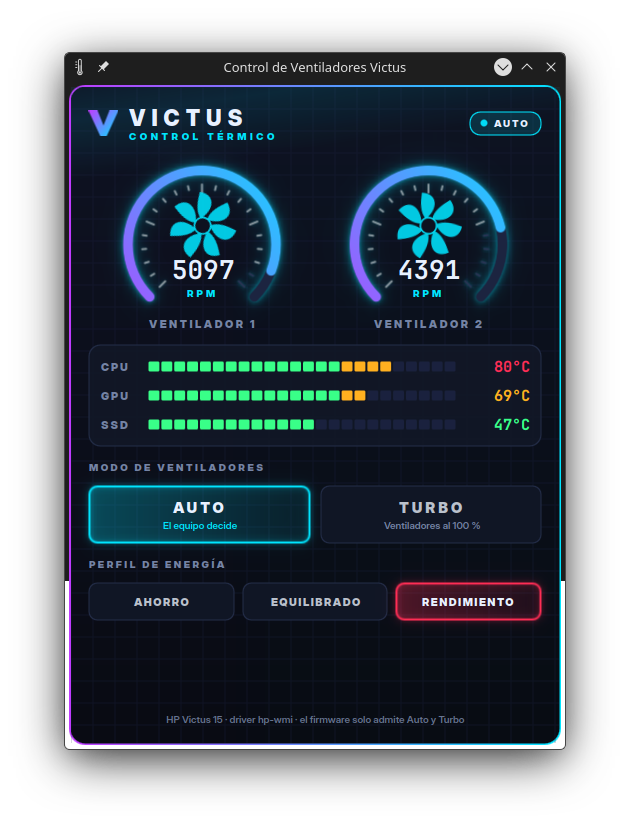

# Victus Fan Control

Widget de **KDE Plasma 6** con estética gamer para controlar los ventiladores y ver las temperaturas de laptops **HP Victus / Omen** en Linux, usando el driver `hp-wmi` que ya viene en el kernel. No hace falta compilar módulos ni instalar DKMS.



## Qué hace

- **Medidores de RPM en vivo** de los dos ventiladores, con rotores animados que giran según la velocidad real.
- **Temperaturas** de CPU, GPU NVIDIA y SSD con barras de color (verde, ámbar, rojo).
- **Modo de ventiladores:** `AUTO` (lo decide el firmware) o `TURBO` (máximo, 100 %). Si el firmware vuelve solo a automático, el widget reaplica tu elección.
- **Perfil de energía:** Ahorro, Equilibrado o Rendimiento, mediante `power-profiles-daemon` o `tuned-ppd` (el mismo servicio que usa el applet de batería de Plasma).
- **Cuida la batería:** solo consulta la temperatura de la GPU NVIDIA cuando ya está despierta, para no sacarla del modo de reposo.
- Vive en la **bandeja del sistema** y también se abre como ventana desde el menú: *Control de Ventiladores Victus*.

## Requisitos

- KDE Plasma 6
- Laptop HP con el driver `hp-wmi` que expone `/sys/devices/platform/hp-wmi/hwmon/hwmon*/fan1_input` y `pwm1_enable`
- Opcional: `nvidia-smi` para la temperatura de la GPU

Probado en una **HP Victus 15-fa0xxx (placa 8A4F)** con Fedora Kinoite 44 y Plasma 6.7.

## Instalación

```bash
git clone https://github.com/riqgonzalo/victus-fan-control.git
```

```bash
cd victus-fan-control && ./install.sh
```

El instalador:

1. instala el widget con `kpackagetool6`;
2. agrega el lanzador al menú de aplicaciones;
3. instala una regla udev en `/etc/udev/rules.d/90-hp-victus-fan.rules`, que permite a tu grupo administrador (`wheel` o `sudo`) cambiar el modo de los ventiladores. Este paso pide tu contraseña.

Si no quieres la regla udev, usa `./install.sh --no-root`: el widget mostrará los datos, pero los botones AUTO/TURBO quedarán desactivados.

Para agregarlo al panel: clic derecho en el panel → **Añadir elementos gráficos** → *Control de Ventiladores Victus*, o actívalo en la configuración de la bandeja del sistema.

## Desinstalación

```bash
./uninstall.sh
```

## Sobre el control manual de RPM

En muchos modelos (por ejemplo el **Victus 15-fa0**), el firmware de HP solo acepta dos modos: **automático** (`pwm1_enable = 2`) y **máximo** (`pwm1_enable = 0`). Rechaza el modo manual (`1`), así que no se puede fijar una velocidad exacta. Algunos Victus/Omen más nuevos están recibiendo soporte de control manual en versiones recientes del kernel; este widget usa lo que el driver del kernel expone.

## Estructura

```
package/                     paquete del widget (Plasma/Applet)
  contents/ui/*.qml          interfaz (QML)
  contents/code/victus-fan.sh  lectura de sensores y cambio de modo
system/                      regla udev (plantilla) y lanzador .desktop
install.sh / uninstall.sh
```

## Licencia

[GPL-3.0-or-later](LICENSE)
